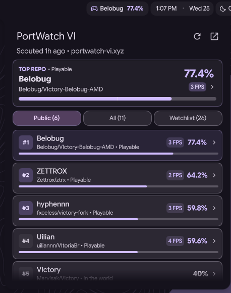

# PortWatch VI

A [Dux Modular Shell (DMS)](https://github.com/duxlabs-dev/dux-shell) DankBar widget that tracks GTA VI PC port progress from [4lwayz/portwatch-vi](https://github.com/4lwayz/portwatch-vi).



## Features

- Shows the current top public repo and completion percentage in the top bar (plus optional FPS or compact modes, and vertical bar support).
- Clicking the pill opens a leaderboard of tracked projects with their percentages, milestone stages, and current FPS (`Public`, `All`, and `Watchlist` views).
- Clicking any repo opens a detail view with its pros, cons, stability, FPS, and a link to its GitHub repository.
- Fetches `data/tracker.json` directly from GitHub using `dms dl` and caches the last response locally (right-click the bar pill to refresh).

## Installation

1. Clone into your DMS plugins directory:

   ```bash
   mkdir -p ~/.config/dms/plugins
   git clone https://github.com/jhannesreimann/dux-portwatch.git ~/.config/dms/plugins/PortWatchVI
   ```

2. Rescan and enable the plugin:

   ```bash
   dms ipc call plugin-scan scan
   ```

   Open **DMS Settings → Plugins** (set **Filter** to **All** if it doesn't show up under **Enabled**), enable **PortWatch VI**, and add it to your DankBar layout.

## Settings

- **Bar Label Style**: `Repo + Percentage`, `Short Tag + Percentage`, or `Percentage Only`
- **Show FPS in Top Bar**: Append FPS when `> 0`
- **Include Private Builds in Top Bar**: Allow unlinked private builds (`repo: null`) to appear as the #1 bar leader
- **Refresh Interval**: Polling interval in minutes (5–180 min, default 15 min)

## Testing

```bash
node tests/model.test.mjs
```
